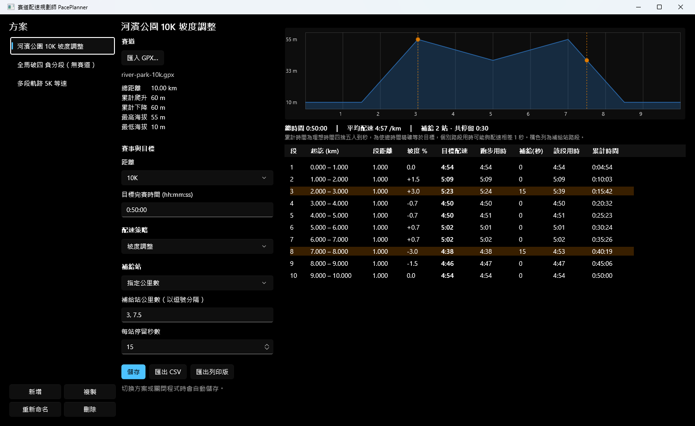
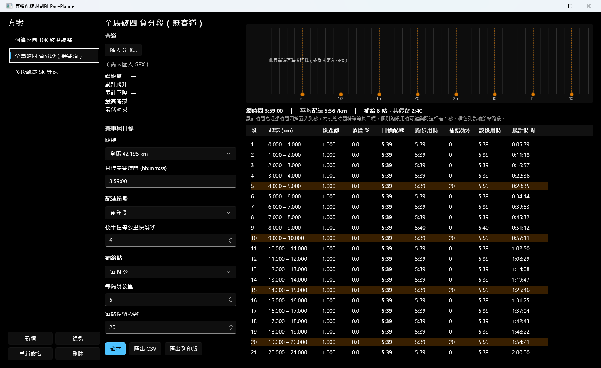
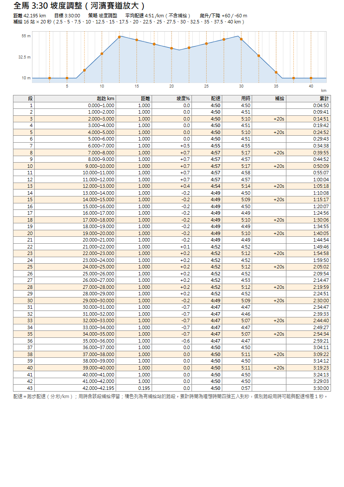

# 賽道配速規劃師 PacePlanner

[](https://github.com/hn83320589/PacePlanner/actions/workflows/ci.yml)

PacePlanner 是給跑團教練用的 Windows 桌面小工具。匯入賽道 GPX 後，選擇距離、目標時間和配速策略，就能算出**每公里配速表**，並匯出 CSV 或可列印的 A4 口袋配速卡。全程離線運作，不呼叫任何網路服務。



## 功能

| 功能 | 說明 |
|---|---|
| 匯入 GPX | 讀取 `<trk>`（可含多個 `<trkseg>`），顯示總距離、累計爬升／下降、最高／最低海拔。格式錯誤、空檔、非 XML 檔會顯示明確訊息，不會崩潰 |
| 賽事與目標 | 5K、10K、半馬 21.0975 km、全馬 42.195 km 或自訂距離；目標完賽時間輸入 `hh:mm:ss` |
| 配速策略 | 等速、負分段（後半程每公里快 N 秒）、坡度調整 |
| 分段配速表 | 每公里一段，最後一段依實際距離計算。每段顯示起訖公里、段距離、平均坡度、目標配速（分:秒/km）、跑步用時、補給停留、該段用時、累計時間 |
| 補給站 | 可設「每 N 公里」或「指定公里數清單」，每站停留 X 秒，停留時間計入總時間 |
| 海拔剖面圖 | 自行繪製（不依賴圖表套件），顯示全程海拔、公里分隔線和補給站標記 |
| 方案管理 | 存在本機 SQLite，可新增、複製、重新命名、刪除、重新開啟。切換方案或關閉程式時自動儲存 |
| 匯出 | CSV（UTF-8 with BOM，Excel 直接開不會亂碼）、可列印的 HTML（單頁 A4 直式） |

| 全馬 + 負分段 + 每 5 km 補給 | 列印版（HTML，A4 單頁） |
|---|---|
|  |  |

## 建置與執行

**需求**：Windows 10 1809（17763）以上、x64、[.NET 9 SDK](https://dotnet.microsoft.com/download/dotnet/9.0)。不需要 Visual Studio，也不需要另外安裝 Windows App SDK Runtime（已以 self-contained 方式隨程式附帶）。

```powershell
git clone https://github.com/hn83320589/PacePlanner.git
cd PacePlanner

dotnet build PacePlanner.sln -c Release   # 建置全部專案
dotnet test  PacePlanner.sln -c Release   # 執行單元測試

# 執行桌面程式（unpackaged）
dotnet run --project src/PacePlanner.App -c Release
# 或直接執行
.\src\PacePlanner.App\bin\x64\Release\net9.0-windows10.0.19041.0\win-x64\PacePlanner.exe
```

資料庫位置：`%LocalAppData%\PacePlanner\plans.db`。刪除這個檔案就能回到初始狀態。

### 快速試用

1. 啟動後會自動建立「我的第一個方案」。
2. 按「匯入 GPX…」，選擇 `samples/river-park-10k.gpx`。
3. 距離選「10K」，目標輸入 `0:50:00`，策略選「坡度調整」。
4. 補給選「指定公里數」，輸入 `3, 7.5`，每站停留 15 秒。
5. 按「匯出列印版」，瀏覽器會開啟配速卡，按 Ctrl+P 即可列印。

## 架構

```
PacePlanner.sln
├─ src/PacePlanner.Core     net9.0（不引用 WinUI）
│   ├─ Gpx/          GpxParser、Track、GpxFormatException
│   ├─ Course/       GeoMath（Haversine）、ElevationAnalyzer（遲滯爬升）、CourseProfile（距離／海拔剖面、縮放、內插）
│   ├─ Pacing/       PaceCalculator（三種策略＋補給＋整數秒對齊）、PlanSettings、AidStationListParser
│   ├─ Charts/       ProfileChartLayout（剖面圖的純幾何計算，UI 與 SVG 共用）
│   ├─ Formatting/   TimeFormat（hh:mm:ss 解析、m:ss 配速）
│   └─ Export/       SplitTable（列格式）、CsvExporter、HtmlExporter、SvgProfileRenderer
├─ src/PacePlanner.Data     net9.0：PlanRepository（Microsoft.Data.Sqlite）、SavedPlan
├─ src/PacePlanner.App      WinUI 3（Windows App SDK 1.8，unpackaged）、MVVM（CommunityToolkit.Mvvm）
│   ├─ ViewModels/MainViewModel   輸入狀態、指令、即時重算、自動儲存
│   ├─ Services/IUiServices       檔案選擇器與對話框的抽象（由 MainWindow 實作）
│   └─ MainWindow                 版面、剖面圖繪製（Canvas）
└─ tests/
    ├─ PacePlanner.Core.Tests     xUnit：GPX、統計、策略、補給、格式、匯出、範例檔
    └─ PacePlanner.Data.Tests     xUnit：SQLite 存取（用暫存檔，含關閉重開驗證）
```

相依方向：`App → Data → Core`，以及 `App → Core`。所有可測試的邏輯都放在 Core，App 只負責繫結與繪製：

* **畫面、CSV、HTML 用同一個 `SplitTable.ToRow` 產生文字**，三者的數字不會不一致。
* **剖面圖的座標由 `ProfileChartLayout` 計算**。WinUI Canvas 和列印用的 SVG 都從同一份幾何繪製，這份幾何本身有單元測試。

使用的套件（皆為 MIT 授權、免費）：CommunityToolkit.Mvvm、Microsoft.Data.Sqlite、Microsoft.WindowsAppSDK、xUnit。

## 計算方式

### 距離
相鄰軌跡點以 **Haversine** 公式計算（地球半徑 6,371 km）。多個 `trkseg` 依檔案順序串接，**段與段之間的空隙不計入距離**，因為那通常是手錶暫停造成的。

### 累計爬升／下降（遲滯門檻）
直接把每個海拔差相加，GPS 雜訊會被放大成大量假爬升。本程式使用 **3 m 遲滯門檻**：記下一個參考海拔，只有離它超過 ±3 m 時才把差值計入爬升或下降，並更新參考點。

* 持續的小步爬坡（每點 +1 m）仍會完整計入。
* 擺幅小於 3 m 的抖動完全忽略。範例 `noisy-gps-3k.gpx` 直接相加是 66 m，遲滯法得到的是正確的 30 m。
* 沒有 `<ele>` 的點會略過統計。整檔都沒有海拔時，坡度一律視為 0。

### 官方距離縮放
GPS 量到的距離通常和官方距離不同（例如 42.6 km 對 42.195 km）。計算前會把剖面**等比例縮放**到所選的官方距離，所以分段一定是官方的整公里，畫面摘要也會顯示「GPX 實測 X km 已縮放為 Y km」。

### 分段與坡度
從 0 km 起每 1 km 切一段，最後一段不足 1 km 時依實際距離計算（例如全馬第 43 段為 0.195 km）。各段的**平均坡度 = (段終點海拔 − 段起點海拔) ÷ 段距離**，兩端海拔由剖面線性內插而得。這是淨坡度，段內的起伏會互相抵消，也因此不受雜訊影響。

### 三種策略
令 T = 目標時間 − 補給站數 × 每站停留秒數（可跑時間），D = 總距離，dᵢ = 第 i 段距離，pᵢ = 第 i 段配速（秒/km）。每種策略都滿足 **Σ dᵢ·pᵢ = T**。

| 策略 | 公式 |
|---|---|
| 等速 | pᵢ = T / D |
| 負分段 | 前半程 p₁、後半程 p₂ = p₁ − N。由 p₁·D/2 + (p₁ − N)·D/2 = T 得 **p₁ = (T + N·D/2) / D**。跨越中點的那一段依兩邊距離加權平均。若 p₂ ≤ 0 則提示 N 太大 |
| 坡度調整 | pᵢ = B · f(gᵢ)，其中 **B = T / Σ dᵢ·f(gᵢ)**，所以總時間不變，平路段的配速就是 B |

**坡度係數 f(g)**（g 為坡度百分比）：

| 坡度 | f(g) | 例子 |
|---|---|---|
| 上坡 g ≥ 0 | 1 + 0.033 · min(g, 30) | +3 % → 慢 9.9 % |
| 下坡 g < 0 | 1 − 0.018 · min(\|g\|, 8) | −3 % → 快 5.4 %；−8 % 以下不再加快 |

依據與取捨：
* **上坡每 1 % 慢約 3.3 %**：跑者常用的經驗法則是每 1 % 上坡約慢 3～4 %（以 5:00/km 而言約 10～12 秒/km）。這裡取區間偏低的值，因為比賽中的上坡通常不長。
* **下坡只回收約一半（1.8 %）**：下坡省下的力氣明顯少於上坡多花的，這和坡度跑步的能量成本研究（如 Minetti et al., 2002）的趨勢一致：能量成本在中等下坡時最低，坡度再陡反而增加。
* **下坡超過 −8 % 不再加快**：陡下坡需要煞車，還要考慮股四頭肌的離心負荷和安全，業餘跑者在這種坡度通常無法再加速。
* **上坡封頂 30 %**：避免 GPS 海拔突波或階梯造成不合理的配速。
* 這些係數是寫在 `PaceCalculator` 的常數，屬於可調整的設計假設，不宣稱與任何商業演算法一致。

### 補給站
* 「每 N 公里」：N、2N、3N…，不含起點和終點。
* 「指定清單」：可用逗號、頓號或空白分隔，例如 `5, 10.5、21`。超出範圍或重複的值會自動略過。
* 停留時間加在該站所在路段的「該段用時」與累計時間上。補給站剛好落在整公里處時（例如 5 km），算在結束於該點的路段。配速以扣掉停留時間後的可跑時間計算，所以**抵達終點的時間仍等於目標時間**。

### 整數秒對齊
各段的理論時間是小數，但表格必須以整數秒顯示，而且加總要剛好等於目標。做法是**對累計時間四捨五入**，各段用時就是相鄰兩個累計時間的差：

* 每個累計時間，都是理想時間最接近的整數秒。
* 最後一格累計時間剛好等於目標時間，各段用時加總也一定等於累計欄。
* 因為要湊到精確總和，少數路段的用時會和顯示的配速相差 1 秒。這些調整會平均分散在整條賽道上，畫面和列印版都有附註說明。

## 範例資料

`samples/` 內含 4 個 GPX 以及 `invalid/` 下的 5 個錯誤檔，預期統計值與設計說明請見 [`samples/expected-stats.md`](samples/expected-stats.md)，並由 `SampleFilesTests` 自動驗證。這些賽道沿經線前進，海拔使用二進位可精確表示的步長，所以預期值可以手算驗證。可用 `pwsh samples/generate-samples.ps1` 重新產生。

| 檔案 | 用途 |
|---|---|
| `river-park-10k.gpx` | 一般賽道（10 km 折返，爬升／下降各 60 m） |
| `multi-segment-5k.gpx` | 3 個 trkseg，中間有 200 m 暫停空隙 |
| `noisy-gps-3k.gpx` | 海拔與座標雜訊、部分點缺海拔、沒有時間 |
| `no-elevation-5k.gpx` | 完全沒有海拔 |

## 驗收標準對照

| # | 標準 | 驗證方式 |
|---|---|---|
| 1 | 範例統計正確 | `SampleFilesTests`、實測 |
| 2 | 多 trkseg 完整匯入且順序正確 | `GpxParserTests.Parse_MultipleSegmentsAndTracks_KeepsDocumentOrder`、`SampleFilesTests.MultiSegment5k_*` |
| 3 | 損毀／空檔／非 XML 不崩潰 | `GpxParserTests.Parse_BadInput_*`、`SampleFilesTests.InvalidSamples_*`、實測（`samples/invalid/`） |
| 4 | 等速 | `PaceCalculatorTests.Even_*` |
| 5 | 負分段 | `PaceCalculatorTests.NegativeSplit_*` |
| 6 | 坡度調整 | `PaceCalculatorTests.GradeAdjusted_*`、`GradeFactor_*` |
| 7 | 補給站 | `PaceCalculatorTests.AidStations_*` |
| 8 | 分:秒顯示、用時與累計一致 | `TimeFormatTests`、`AssertCumulativeConsistent`、實測 |
| 9 | 剖面圖 | `ProfileChartLayoutTests`、實測 |
| 10 | 方案儲存／複製／改名／刪除、重開不變 | `PlanRepositoryTests`（含重開資料庫）、實測 |
| 11 | CSV 不亂碼、HTML 單頁 A4 | `ExportTests`；以 Excel 開啟確認中文標題正常；以 Edge 列印成 PDF 確認全馬、60K、100K 皆為 1 頁 A4 |
| 12 | ≥ 20 個單元測試 | 目前共 105 個（Core 96、Data 9） |
| 13 | README | 本文件 |
| 14 | CI | `.github/workflows/ci.yml`（windows-latest、setup-dotnet 9.0.x） |

## 設計取捨

* **只用 Microsoft.Data.Sqlite，不用 EF Core**：只有一張表，手寫 SQL 比 migration 簡單透明。
* **GPX 內容存進資料庫**：原始檔案被搬走或刪除後，方案仍能重新開啟。
* **剖面圖自己畫**：需求很單純（折線、分隔線、標記），自己畫可以避免引入圖表套件，同一份幾何也能輸出成 SVG 放進列印版。
* **ViewModel 放在 App 專案**：ViewModel 很薄，計算、解析、格式化都在 Core 並有測試，所以沒有再多拆一個 Presentation 專案。
* **ViewModel 用欄位式 `[ObservableProperty]`**：CommunityToolkit.Mvvm 8.4 的 partial property 寫法需要 `LangVersion=preview`，為了不使用預覽語言功能，改用欄位寫法，並在 App 專案抑制 MVVMTK0045（WinRT AOT 相容性提示，本專案不做 Native AOT 發佈）。
* **自動儲存時機**：切換方案或關閉視窗時，如果有變更才寫入，避免每打一個字就寫一次資料庫。
* **檔案選擇器使用 Windows App SDK 1.8 的 `Microsoft.Windows.Storage.Pickers`**：舊的 `Windows.Storage.Pickers` 在系統管理員權限下執行時會失敗。

## 已知限制

* 只處理 `<trk>`，忽略 `<wpt>`、`<rte>`；時間戳記不參與計算。
* 單位固定為公尺、公里、分:秒/km，沒有英制。
* 遲滯門檻固定 3 m。氣壓計資料很平滑的 GPX 可能會略為低估小起伏。
* 坡度是以整段的淨坡度計算。同一公里內先爬後降的路段會被視為接近平路。
* 用 Excel 開啟 CSV 時，「配速」欄的 `4:50` 會被自動辨識成時間格式（顯示為 04:50）；用時類欄位則刻意輸出為 `0:04:50`，方便在 Excel 中加總。
* 個別路段的用時可能和配速相差 1 秒（見「整數秒對齊」）。
* 僅建置 x64。
